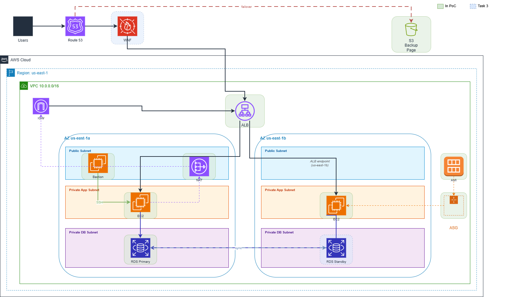
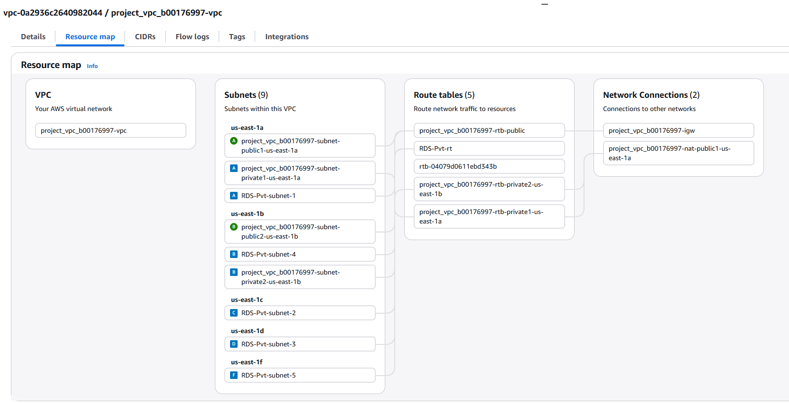
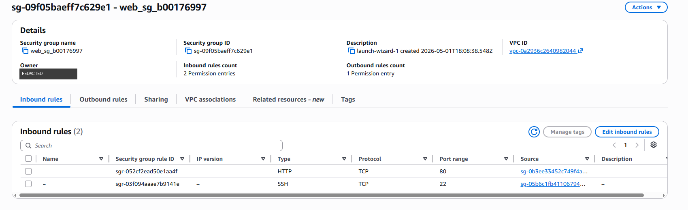
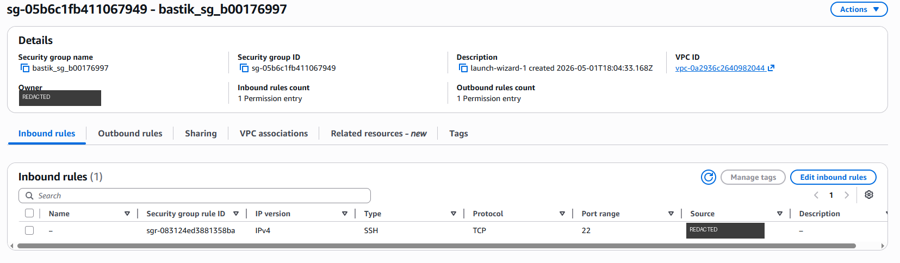
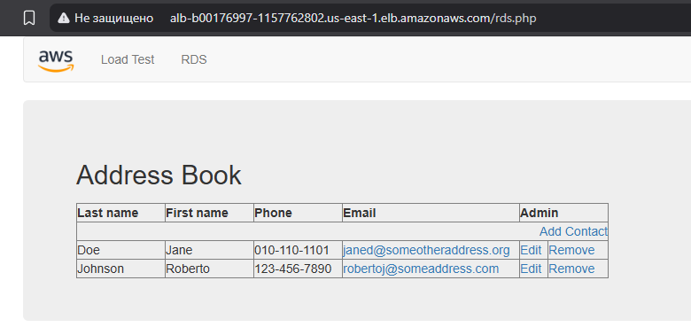
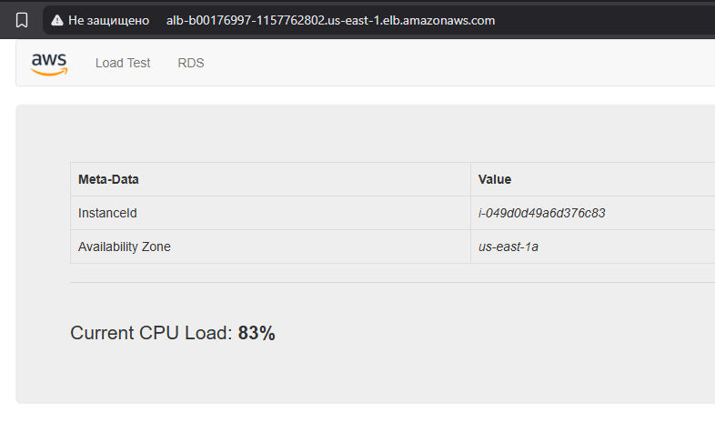
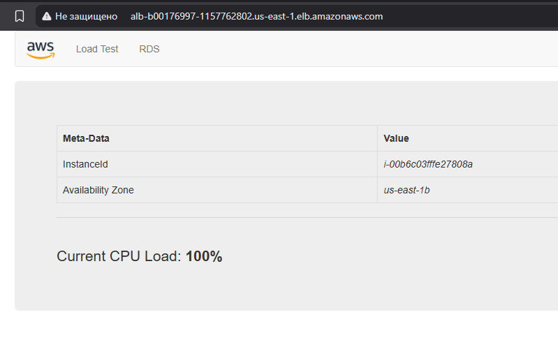
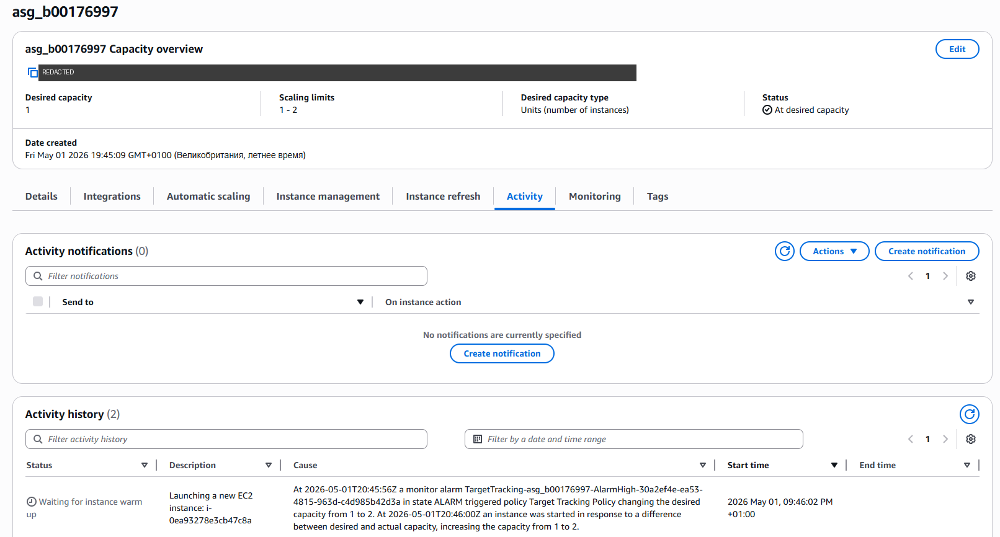
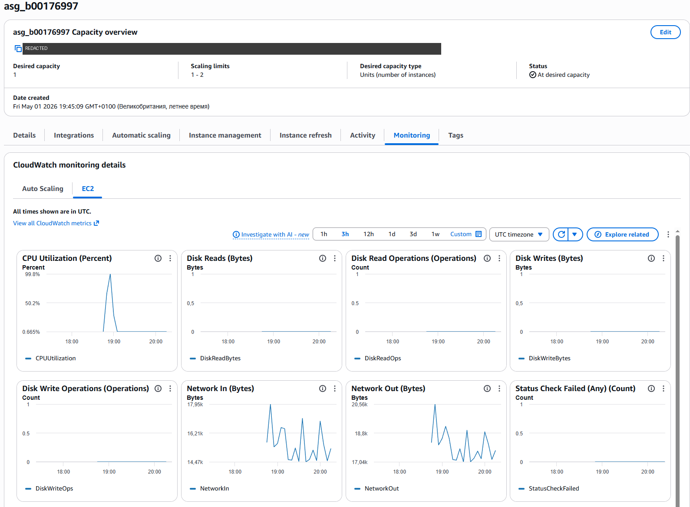

# Secure AWS Cloud Migration — Proof of Concept

**A highly available, segmented three-tier AWS architecture for a company recovering from a ransomware breach, built and tested as a working proof of concept.**

TU Dublin · Security Architecture module · April–May 2026 · AWS Academy Learner Lab (`us-east-1`)

---

## The scenario

*WinLocal Giveaways* (a case-study company) runs online competitions for local businesses. Its on-premises platform had four problems:

1. a failing load balancer → outages;
2. an unreliable database that ran out of disk space;
3. no way to scale during promotional traffic spikes;
4. a **ransomware breach that started in the web application and went undetected for ten weeks**, helped by a flat network that allowed lateral movement.

The goal: move to AWS on a platform that is highly available, scalable, secure by design and cost-efficient.

## Architecture

*Green = built in the proof of concept. Blue = designed and justified, but not built in the lab (AWS WAF, Multi-AZ RDS).*

| Layer | What I built | Why (security / reliability) |
|---|---|---|
| Network | Custom VPC `10.0.0.0/16`, public, private app and private DB subnets across two Availability Zones, Internet Gateway, NAT Gateway | Segmentation stops an attacker who compromises the web tier from reaching the database directly: the lateral movement used in the original breach |
| Admin access | Bastion host in the public subnet; SSH allowed **only from one trusted IP** | No private instance is exposed to the internet; one auditable entry point |
| Web tier | EC2 web servers from a custom AMI, in an Auto Scaling Group (min 1, max 2, target 60% CPU) | Consistent, repeatable servers; automatic scale-out during traffic spikes |
| Traffic | Application Load Balancer across both AZs | Replaces the failing on-prem load balancer; survives the loss of one AZ |
| Data | Amazon RDS MySQL in isolated private subnets | Managed storage, backups and patching; not reachable from the internet |
| Access control | Layered Security Groups: web tier accepts HTTP **only from the ALB** and SSH **only from the bastion** | Least privilege between tiers |
| Failover | Static backup page on S3, designed for Route 53 DNS failover | Users still see a status page if the application is down |

## Evidence: the PoC working

**Network segmentation:** VPC resource map with public, private and DB subnets in multiple AZs.

**Least-privilege Security Groups:** the web tier accepts HTTP only from the ALB's security group and SSH only from the bastion's.

**Bastion locked down:** SSH (TCP/22) allowed from a single /32 source address (redacted here).

**End-to-end connectivity:** a public request goes through the ALB to a private EC2 instance and reads records from private RDS.

**Load balancing across Availability Zones:** two requests to the same ALB address are answered by different instances in `us-east-1a` and `us-east-1b`.

| us-east-1a | us-east-1b |
|---|---|
|  |  |

**Auto Scaling tested under load:** I pushed an instance to **99.8% CPU**. The target-tracking alarm fired and the group scaled **from 1 to 2 instances**.

## Designed but not built in the lab

- **AWS WAF in front of the ALB:** managed rule groups (Core Rule Set, SQL database) plus rate limiting, to block OWASP Top 10 attacks such as SQL injection and XSS before they reach EC2. The original breach came through the web application, so this is the next control I would add.
- **Multi-AZ RDS:** a synchronous standby in a second AZ removes the database as a single point of failure, with automatic failover in about 1–2 minutes.

## Sustainability and cost

Right-sized `t2.micro` instances, scale-in when demand drops, managed RDS instead of self-hosted MySQL, and S3 instead of EC2 for the rarely used failover page. A next step would be Graviton (`t4g`) instances.

## What I learned

- Designing **defence in depth** in practice: segmentation, bastion, chained security groups, and how each one maps to a weakness in the original incident.
- Proving that a design works, not just drawing it: generating load to trigger scaling and checking which AZ answered each request.
- Being honest about limits: Single-AZ RDS and no WAF in the PoC, with the fix for each documented.

## Tools and frameworks

AWS VPC · EC2 · AMI · Auto Scaling · Application Load Balancer · RDS (MySQL) · S3 · Security Groups · IAM · CloudWatch · Route 53 (design) · AWS WAF (design) · draw.io · AWS Well-Architected Framework · NIST CSF 2.0 · OWASP Top 10

## My contribution

[ПРОВЕРЬ И ПОПРАВЬ] I designed the architecture and built and tested the whole proof of concept on my own in the AWS Academy Learner Lab, and wrote the individual report. The architecture was then presented as part of a group presentation with Vsevolod and Mykyta.

> Note: the lab environment has been shut down. Account identifiers and my IP address are redacted from the screenshots.

---

*Author: Vladyslav Shkurina — Cybersecurity student, TU Dublin · [LinkedIn](https://www.linkedin.com/in/vladyslav-shkurina-b3a324339/)*
